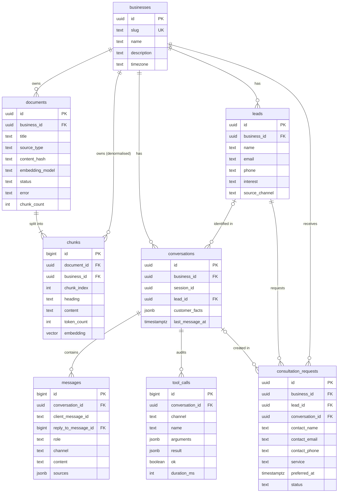
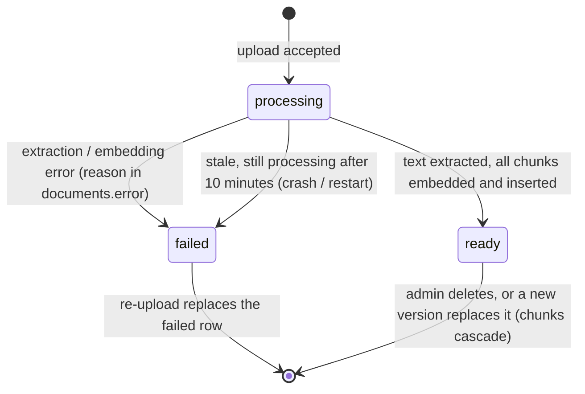
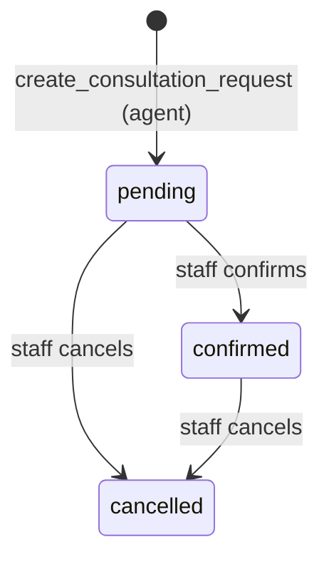

# Database Design

| | |
|---|---|
| **Scope** | Postgres schema for the AI Customer Assistant (Supabase + pgvector) |
| **Status** | Proposed: implemented by PR-02 |
| **Related** | [User stories](./user-stories.md) · [Delivery plan](./project-plan.xlsx) (Decision Log D-05, D-06, D-10, D-11) |

---

## 1. Goals and principles

1. **The database enforces the business rules.** Duplicate leads, duplicate consultation requests, and leads with no contact method are rejected by Postgres itself, not just by application code. The AI agent may retry a tool call; the schema makes those retries safe.
2. **One database for everything.** Relational data and vector embeddings live in the same Postgres. One backup, one transaction boundary, and a business's documents can be filtered and joined in the same query as their vectors.
3. **Multi-tenant from day one.** Every row belongs to a `business`. The demo serves one business, but no table assumes that.
4. **Locked down by default.** Row-Level Security is on for every table with no policies. Only the server (service role) can read or write.
5. **Store what we need, nothing more.** No audio, no original files, and only the contact fields required for follow-up.

---

## 2. Entity-relationship diagram



The model has three groups:

| Group | Tables | Written by |
|---|---|---|
| **Knowledge** | `businesses`, `documents`, `chunks` | Admin (upload) and the ingestion pipeline |
| **Conversation & memory** | `conversations`, `messages`, `tool_calls` | Chat API and voice relay |
| **Agent actions** | `leads`, `consultation_requests` | Agent tools (`save_lead`, `create_consultation_request`); status changes by admin |

---

## 3. Data dictionary

Conventions used in every table:
- `created_at timestamptz not null default now()`. All timestamps are `timestamptz` and stored in UTC; the UI converts to `businesses.timezone`.
- **Exception, `messages` and `tool_calls`:** `created_at default clock_timestamp()`. `now()` is the *transaction start* time, so rows written close together could tie or come out of order. The admin transcript interleaves these two tables by `created_at`, so it needs the real insert time.
- **Derived timestamps are kept by triggers, not app code:** `updated_at` on `leads` and `consultation_requests` (a `BEFORE UPDATE` trigger), and `conversations.last_message_at` (an `AFTER INSERT` trigger on `messages`). Setting them in app code is easy to forget in one code path.
- Status-like columns use `text` + `CHECK (... in (...))` rather than Postgres `ENUM` (see §10).
- `on delete cascade` from `businesses`: deleting a business removes all its data.

### 3.1 `businesses`

| Column | Type | Null | Default | Notes |
|---|---|---|---|---|
| `id` | uuid | no | `gen_random_uuid()` | PK |
| `slug` | text | no | | **Unique.** URL/config identifier, e.g. `lakeside-dental` |
| `name` | text | no | | Shown in chat header and system prompt |
| `description` | text | no | `''` | One-paragraph summary used in the system prompt |
| `timezone` | text | no | `'America/Los_Angeles'` | IANA name. Used to resolve "next Tuesday at 3pm" and to display times |
| `created_at` | timestamptz | no | `now()` | |

### 3.2 `documents`

One uploaded file. The extracted text lives in `chunks`; the original file is not stored.

| Column | Type | Null | Default | Notes |
|---|---|---|---|---|
| `id` | uuid | no | `gen_random_uuid()` | PK |
| `business_id` | uuid | no | | FK → `businesses`, cascade |
| `title` | text | no | | Shown in source chips; defaults to the file name. At most one `ready` document per title (see I13 and §6.1, replacing a document) |
| `source_type` | text | no | | `txt` \| `md` \| `pdf` |
| `content_hash` | text | no | | SHA-256 of the extracted text. **Unique per business** → re-uploading the same content is a no-op (US-7.2) |
| `embedding_model` | text | no | | Model that produced this document's vectors, e.g. `text-embedding-3-small`. Vectors from different models are not comparable, so re-indexing is needed if this changes |
| `status` | text | no | `'processing'` | `processing` \| `ready` \| `failed` (lifecycle §6.1) |
| `error` | text | yes | | Human-readable failure reason when `status = 'failed'` |
| `chunk_count` | int | no | `0` | Number of chunks indexed |
| `created_at` | timestamptz | no | `now()` | |

### 3.3 `chunks`

A section of a document plus its embedding. This is what retrieval searches.

| Column | Type | Null | Default | Notes |
|---|---|---|---|---|
| `id` | bigint identity | no | | PK. Internal, high-volume → bigint, not uuid |
| `document_id` | uuid | no | | FK → `documents`, cascade |
| `business_id` | uuid | no | | FK → `businesses`, cascade. **Denormalised** so vector search filters by tenant without a join |
| `chunk_index` | int | no | | Order within the document. `unique (document_id, chunk_index)` |
| `heading` | text | no | `''` | Section path, e.g. `Pricing › Whitening`. Shown in source chips |
| `content` | text | no | | The chunk text shown in source previews |
| `token_count` | int | no | | For context-budget decisions and debugging chunk sizes |
| `embedding` | vector(1536) | no | | Embedding of `title › heading` + `content` |

### 3.4 `conversations`

One per anonymous browser session per business, so returning visitors continue the same conversation across text and voice (US-6.2, US-6.4).

| Column | Type | Null | Default | Notes |
|---|---|---|---|---|
| `id` | uuid | no | `gen_random_uuid()` | PK |
| `business_id` | uuid | no | | FK → `businesses`, cascade |
| `session_id` | uuid | no | | Random UUID generated in the browser (`crypto.randomUUID()`), kept in localStorage. `unique (business_id, session_id)` |
| `lead_id` | uuid | yes | | FK → `leads`, **set null** on lead delete. Links the conversation to the lead for the **admin** (lead → conversation). The agent never reads the lead row through this link (see §7) |
| `customer_facts` | jsonb | no | `'{}'` | Contact details the customer gave **in this conversation**: `{name, email, phone, interest}`. This, not the `leads` row, is what the agent sees as memory (US-6.3) |
| `created_at` | timestamptz | no | `now()` | |
| `last_message_at` | timestamptz | no | `now()` | Maintained by trigger on `messages` insert. Sorts the admin conversation list |

### 3.5 `messages`

The user-visible turns only. Tool traffic goes to `tool_calls` (see §10, alternative A3).

| Column | Type | Null | Default | Notes |
|---|---|---|---|---|
| `id` | bigint identity | no | | PK. Monotonic and assigned when the turn *happens* (see voice ordering below), so it is the ordering key |
| `conversation_id` | uuid | no | | FK → `conversations`, cascade |
| `client_message_id` | text | yes | | **Idempotency key.** Text messages: a UUID the browser generates per message and reuses on retry. Voice turns: the Realtime API's item id. `unique (conversation_id, client_message_id)`, so a retried send is never stored twice (US-11.6). Null for server-generated text replies |
| `reply_to_message_id` | bigint | yes | | Assistant rows only: FK → the user message this answers. `UNIQUE`, so a user message has at most one stored reply. This is what makes retries safe (§7.1) |
| `role` | text | no | | `user` \| `assistant` |
| `channel` | text | no | `'text'` | `text` \| `voice`. Voice rows hold transcripts |
| `content` | text | yes | | `CHECK (content <> '')` when present. **Null only for a voice turn whose transcript hasn't arrived yet** (`CHECK (content IS NOT NULL OR channel = 'voice')`). Null rows are skipped when building the prompt and shown as "…" in the UI |
| `sources` | jsonb | no | `'[]'` | Citations attached to an assistant answer: a **self-contained snapshot** copied from `search_knowledge` results, `[{documentId, title, heading, excerpt, similarity}]`. Chips and previews render only from this snapshot, never by joining `documents`, so they keep working after a document is deleted or replaced. `documentId` is informational (no FK); the UI labels a chip whose document no longer exists as "from a removed document" |
| `actions` | jsonb | no | `'[]'` | Action cards an assistant reply produced (`lead_saved`, `consultation_requested`, `action_failed`), copied from tool results by the server, so they survive a reload |
| `reply_attempt_at` | timestamptz | no | `now()` | User rows: when the latest attempt to answer started. The in-progress window counts from here (§7.1) |
| `reply_failed_at` | timestamptz | yes | | User rows only: set when the server gave up producing the reply (model error, deadline). Lets a retry re-run at once instead of waiting out the in-progress window (§7.1) |
| `created_at` | timestamptz | no | `clock_timestamp()` | See conventions |

**Voice turn ordering.** Realtime transcription of the *user's* speech finishes asynchronously, often *after* the assistant has started answering. If transcripts were inserted when they arrive, the answer would get a lower `id` than the question. So a voice turn is stored in **two steps**:
1. When the browser receives `conversation.item.created` (which the Realtime API emits in conversation order), it reports the item and the server inserts the row with `content = NULL`. The `id` is now in the right order. **Only items with `type = 'message'` and role `user` or `assistant` are reported.** The same event also fires for tool-call items, which belong in `tool_calls`, not here.
2. When the transcript completes, the browser sends it and the server fills `content` for that `(conversation_id, client_message_id)`. Both calls are idempotent. **An empty or whitespace-only transcript** (a cough, background noise) is stored as `NULL`, never `''`, which the `CHECK` would reject.

### 3.6 `tool_calls`

Audit log of every tool the agent executed: what it asked for and what it got back (US-9.2).

| Column | Type | Null | Default | Notes |
|---|---|---|---|---|
| `id` | bigint identity | no | | PK |
| `conversation_id` | uuid | no | | FK → `conversations`, cascade |
| `channel` | text | no | | `text` \| `voice` |
| `name` | text | no | | `search_knowledge` \| `save_lead` \| `create_consultation_request` |
| `arguments` | jsonb | no | | Arguments as sent by the model (before validation, so invalid inputs are visible too) |
| `result` | jsonb | no | | The exact payload returned to the model, `{ok, data}` or `{ok:false, error}` |
| `ok` | boolean | no | | Denormalised from `result` for easy filtering of failures |
| `duration_ms` | int | no | | Latency of the tool execution |
| `created_at` | timestamptz | no | `clock_timestamp()` | See conventions |

### 3.7 `leads`

A person who shared contact details with the agent.

| Column | Type | Null | Default | Notes |
|---|---|---|---|---|
| `id` | uuid | no | `gen_random_uuid()` | PK |
| `business_id` | uuid | no | | FK → `businesses`, cascade |
| `name` | text | no | | |
| `email` | text | yes | | Stored lowercase: `CHECK (email = lower(email))`. `unique (business_id, email)` |
| `phone` | text | yes | | Normalised to `+` and digits only by the tool. `unique (business_id, phone)`. Matching on phone is best effort (see §12) |
| `interest` | text | yes | | What they're interested in, e.g. "Invisalign" |
| `source_channel` | text | no | | `text` \| `voice`: where the lead was captured (shown in admin, US-8.1) |
| `created_at` | timestamptz | no | `now()` | |
| `updated_at` | timestamptz | no | `now()` | Set when a later `save_lead` updates the lead |

Table constraint: `CHECK (email IS NOT NULL OR phone IS NOT NULL)`. A lead must be reachable.

**Matching rules for `save_lead` (no overwrite).** Anyone can type any email, so a match by email or phone is *not* proof of identity:
- **No match** → insert a new lead.
- **Match** → link this conversation to the existing lead and **only fill fields that are empty**. Existing name, email, phone and interest are never overwritten from a conversation. Differing details are kept in that conversation's `customer_facts` and visible to staff.
- **Email matches lead A and phone matches lead B** → link to A (email wins); the phone stays only in `customer_facts`. No merge.
- **Filling an empty field would collide with another lead** (e.g. matched lead B by phone, B has no email, but the given email belongs to lead C) → skip that field; the value stays in `customer_facts`. The conversation stays linked to B. No error is shown to the customer.
- **Two `save_lead` calls race on a new email** → the loser's insert hits the unique index; it re-runs the match and follows the rules above.

In every case `customer_facts` holds exactly what the customer said. That is why consultation requests snapshot their contact details from it (§3.8).

### 3.8 `consultation_requests`

A request for a consultation. **Not a booking:** staff confirm it (assumption A3).

| Column | Type | Null | Default | Notes |
|---|---|---|---|---|
| `id` | uuid | no | `gen_random_uuid()` | PK |
| `business_id` | uuid | no | | FK → `businesses`, cascade |
| `lead_id` | uuid | no | | FK → `leads`, cascade. A request always has a reachable person |
| `conversation_id` | uuid | yes | | FK → `conversations`, set null. Where it was requested |
| `contact_name` | text | no | | **Snapshot** of who made the request, copied from `customer_facts` at creation |
| `contact_email` | text | yes | | Snapshot, as above |
| `contact_phone` | text | yes | | Snapshot, as above. `CHECK (contact_email IS NOT NULL OR contact_phone IS NOT NULL)` |
| `service` | text | no | | As named by the customer and confirmed against the documents |
| `preferred_at` | timestamptz | no | | Resolved from natural language using the business timezone, stored in UTC |
| `notes` | text | yes | | |
| `status` | text | no | `'pending'` | `pending` \| `confirmed` \| `cancelled` (lifecycle §6.2) |
| `created_at` | timestamptz | no | `now()` | |
| `updated_at` | timestamptz | no | `now()` | Set on status change |

Unique index: `(conversation_id, lower(service), preferred_at)`. The same request repeated (or retried by the model) in a conversation is stored once, even if capitalisation differs. It is keyed on the **conversation, not the lead**: several different people can be linked to one lead (§3.7), and keying on the lead would silently fold one person's request into another's. Retries always come from the same conversation, so they are still caught.

**Why snapshot the contact details?** Because of the no-overwrite rule, a visitor who types an existing email is linked to someone else's lead. Without a snapshot, staff would see the lead's stored phone and call the wrong person. Staff contact `contact_*` (what the requester actually gave). The admin UI flags a request whose snapshot differs from its lead ("details differ from lead record").

---

## 4. Invariants and where they are enforced

| # | Rule | Enforced by | Story |
|---|---|---|---|
| I1 | A lead has an email or a phone | `CHECK` on `leads` | US-4.1 |
| I2 | One lead per email / per phone per business | `UNIQUE (business_id, email)`, `UNIQUE (business_id, phone)` | US-4.3 |
| I3 | Emails are compared case-insensitively | Stored lowercase + `CHECK (email = lower(email))` | US-4.2 |
| I4 | A consultation request is not duplicated | Partial unique index `(conversation_id, preferred_at) WHERE status <> 'cancelled'`: one open request per time slot per conversation, whatever the service is called (the model's wording varies between calls); a slot staff cancelled can be requested again | US-5.3 |
| I5 | A consultation request always belongs to a lead | `lead_id NOT NULL` + FK | US-5.1 |
| I6 | The same document content isn't indexed twice | `UNIQUE (business_id, content_hash)` | US-7.2 |
| I7 | Chunk order is unambiguous | `UNIQUE (document_id, chunk_index)` | — |
| I8 | One conversation per browser session per business | `UNIQUE (business_id, session_id)` | US-6.2 |
| I9 | Status values are valid | `CHECK (status in (...))` | — |
| I10 | Deleting a document removes it from retrieval | FK `on delete cascade` to `chunks` | US-7.3 |
| I11 | Preferred date is in the future, ≤ 6 months ahead | **Application** (zod in the tool). `CHECK` constraints can't use `now()` reliably, because a row valid when inserted would become "invalid" over time | US-5.2 |
| I12 | Email / phone format is valid | **Application** (zod). Format rules change more often than schema, and errors need friendly wording for the model | US-4.2 |
| I13 | At most one `ready` document per title per business | Partial unique index `(business_id, lower(title)) WHERE status = 'ready'`. Makes the replace-a-document swap (§6.1) safe: two live versions of "Pricing" can't coexist | US-7.3 |
| I14 | A retried message is stored once | `UNIQUE (conversation_id, client_message_id)` | US-11.6 |
| I15 | A conversation can't overwrite another customer's lead details | **Application** (`save_lead` fill-empty-only rule, §3.7). The DB can't know which conversation "owns" a lead | US-12.4 |

**How unique violations are handled.** A raw database error never reaches the model or the customer. But a unique violation (`23505`) means different things depending on **which constraint** fired, so each one has its own rule:

| Constraint | Meaning | Handling |
|---|---|---|
| Consultation dedupe (I4) | The model retried the same request in this conversation | Return success with the existing request's id and status only (rule R1, §8) |
| `(conversation_id, client_message_id)` (I14) | The browser retried a message | Retry flow, §7.1 |
| `(business_id, session_id)` (I8) | Two tabs created the conversation at once | Select the existing row (get-or-create) |
| `leads` email / phone (I2), on **insert** | Two `save_lead` calls raced | Re-run the match, apply §3.7 rules |
| `leads` email / phone (I2), on **fill-empty update** | Value belongs to another lead | Skip that field (§3.7). *Not* a success that returns "the existing row" |
| `(business_id, content_hash)` (I6) | Same document uploaded again | "Already in your knowledge base", or the failed/stale retry (§6.1) |
| Ready-title index (I13) | A live document already has this title | Ask the admin to replace it or rename (§6.1) |
| `UNIQUE (reply_to_message_id)` | A concurrent duplicate turn finished second | Discard the duplicate reply (§7.1) |

The error's constraint name identifies which rule applies.

---

## 5. Access patterns and indexes

Indexes are derived from the queries the app actually runs.

| # | Query | Where | Index |
|---|---|---|---|
| Q1 | Top-k chunks by vector similarity for one business | `search_knowledge` | `chunks USING hnsw (embedding vector_cosine_ops)` + `chunks (business_id)` |
| Q2 | Get-or-create conversation by `(business_id, session_id)` | Every chat request | `UNIQUE (business_id, session_id)`. Race-safe: `INSERT … ON CONFLICT DO NOTHING`, then `SELECT`, so two tabs opening at once both get the same row |
| Q3 | Last 20 messages of a conversation | Every chat request (memory) | `messages (conversation_id, id)` → `WHERE content IS NOT NULL ORDER BY id DESC LIMIT 20` |
| Q4 | Find lead by email or phone | `save_lead` | The two unique indexes on `leads` |
| Q5 | Customer facts for a conversation | Every chat request | Same row as Q2 (`conversations.customer_facts`); no extra query |
| Q5b | Has this message already been stored? | Every chat request (retry) | `UNIQUE (conversation_id, client_message_id)` |
| Q6 | Consultations by business + status, newest first | Admin | `consultation_requests (business_id, status, created_at DESC)` |
| Q7 | Leads by business, newest first | Admin | `leads (business_id, created_at DESC)` |
| Q8 | Conversations by business, most recent activity | Admin | `conversations (business_id, last_message_at DESC)` |
| Q9 | Tool calls of a conversation in order | Admin transcript | `tool_calls (conversation_id, id)` |
| Q10 | Documents of a business | Admin | Leading column of `UNIQUE (business_id, content_hash)` |
| Q11 | Is there a live document with this title? | Upload (replace flow) | Partial unique index `(business_id, lower(title)) WHERE status = 'ready'` |

**Foreign-key indexes.** Postgres does not index FK columns automatically, and an unindexed FK makes parent deletes scan the child table. Every FK is covered, either by its own index or as the **leading column** of a composite index:
- `chunks.document_id` → `UNIQUE (document_id, chunk_index)`
- `consultation_requests.conversation_id` → the dedupe unique index (leading column)
- `messages.reply_to_message_id` → its `UNIQUE` constraint
- `conversations.lead_id`, `consultation_requests.lead_id` → their own indexes

### 5.1 Vector search details

- **Distance:** cosine (`<=>`). OpenAI embeddings are normalised, so cosine is the standard choice. `similarity = 1 − distance`.
- **Index:** HNSW with default parameters (`m = 16`, `ef_construction = 64`). It needs no training step (unlike IVFFlat, which needs data present before building), and it has better recall/latency at small-to-medium scale.
- **Filtered search:** HNSW finds nearest neighbours *first* and applies `WHERE business_id = …` *after*. With many tenants this can return fewer than k rows. The search function enables pgvector's **iterative scan** (`hnsw.iterative_scan = relaxed_order`), so the index keeps scanning until enough rows pass the filter.
- **Threshold:** the search function takes `p_min_similarity`. Below it, results are dropped, and `search_knowledge` returns `found: false` (prevents "loosely related" context reaching the model, US-3.3). The value is tuned with the retrieval eval script (PR-05), not guessed.
- **Outcome of that tuning (PR-05):** no single similarity threshold separates answerable from out-of-scope questions on real data (weakest correct 0.27 vs strongest wrong 0.41), so retrieval is **hybrid**: `hybrid_search()` fuses vector and full-text ranks (RRF), and the found decision requires a *topic keyword* hit plus a low noise floor, or an unambiguous similarity. `chunks.fts` is a generated `tsvector` with a GIN index; `keyword_query()` drops corpus-generic words (> 25% of chunks) and question-frame verbs. See README "Retrieval".

```sql
match_chunks(p_business_id uuid, p_query_embedding vector(1536),
             p_match_count int, p_min_similarity float)
returns table (chunk_id, document_id, document_title, heading, content, similarity)
```

### 5.2 Sizing (back-of-envelope)

| | Demo | Large tenant |
|---|---|---|
| Documents | 6 | 1,000 |
| Chunks | ~50 | ~100,000 |
| Vector storage (1536 × 4 bytes ≈ 6 KB/chunk) | ~300 KB | ~600 MB + HNSW index |

At the large-tenant size this still fits on a single modest Postgres instance. A dedicated vector database isn't needed at this scale.

---

## 6. Lifecycles

### 6.1 Document



- **Replacing a document (new version of the price list).** Without this, uploading an updated price list would leave *both* versions searchable and the assistant could quote the old price. New versions usually have a **different file name** ("Pricing 2025.pdf" → "Pricing 2026.pdf"), so the replace target is **chosen explicitly by the admin**, not inferred from the title:
  1. The upload form has an optional **"Replaces"** select listing the `ready` documents. If the new title matches an existing one, that document is pre-selected and the admin can't upload without either replacing it or renaming (I13).
  2. The new version is extracted and embedded while the old one keeps serving answers.
  3. **One transaction:** insert the new chunks, delete the chosen old document (its chunks cascade), mark the new one `ready`. Customers see either the old version or the new one, never both and never neither.

- **No partial indexing.** All embeddings are computed first, then chunks are inserted in **one statement** (atomic). A failure mid-way leaves zero chunks, and the document is marked `failed` (US-11.5).
- **Stale `processing` rows.** If the server dies mid-ingestion, nothing marks the row `failed`, and its `content_hash` would block re-uploads forever (with a permanent spinner in the admin). Rule: a `processing` row older than **10 minutes** (by `created_at`) is treated as failed. The upload path and the documents list both mark such rows `failed` ("Processing was interrupted, please upload again").
- **Retry after failure.** The `content_hash` uniqueness would block re-uploading a failed file, so ingestion deletes an existing `failed` (or stale) row with the same hash before retrying. A `ready` duplicate is reported as "already in your knowledge base".

### 6.2 Consultation request



The agent can only create `pending` requests. Only the admin changes status (US-8.3). The agent has no tool to confirm, so it cannot claim a booking.

---

## 7. Memory model

How the tables above implement "context & memory" (E6):

| Memory type | Stored in | How it's used |
|---|---|---|
| **Short-term (working) memory** | `messages` | The last 20 messages are loaded server-side on every turn |
| **Long-term facts about the customer** | `conversations.customer_facts` | Injected as a facts block in the system prompt ("Customer: Sara Ali, sara@…, interested in whitening"), so the agent doesn't re-ask. Survives return visits, because the conversation is per browser session |
| **Business knowledge** | `chunks` | Retrieved on demand by `search_knowledge` |
| **What the agent did** | `tool_calls` | Audit and debugging only. **Not** replayed into the prompt |
| **What has been done** | `conversations.lead_id`, `consultation_requests` | A short "already done in this conversation" section in the prompt (contact saved; each request with its live status), so the model doesn't repeat an action when the customer says "yes" again |

**Why the facts come from the conversation, not the `leads` row.** Leads are matched by email or phone, and anyone can type anyone's email. If the agent's memory were the matched lead row, a visitor could type `sara@x.com` and then ask "what phone number do you have for me?", and the agent would read out Sara's phone. Facts from `customer_facts` are only ever what *this* visitor said in *this* conversation, so the agent can never reveal stored data it wasn't told.

### 7.1 Turns and retries

A text turn is: store the user message → run the agent → store the assistant reply with `reply_to_message_id` = the user message. When a request arrives with a `client_message_id` that is already stored:

| State found | Response |
|---|---|
| A reply exists (`reply_to_message_id` = that message) | Return the stored reply. No model call, no tool calls |
| No reply, and the turn is marked failed (`reply_failed_at`) | The original gave up (model error or deadline). Run the agent again at once |
| No reply, and the latest attempt (`reply_attempt_at`) is **< 60 s old** | The original request is probably still running: `409 in progress`. The browser shows "Still working…" and reloads history shortly |
| No reply, and the latest attempt is **≥ 60 s old** | The original died. Run the agent again for that message |

**Turn deadline.** A whole turn (all model calls and tool calls) has a hard limit of **45 s**; when it expires the turn stops and stores the fallback reply. Without this, a slow but live turn could pass the 60 s mark and a retry would start a second copy of it in parallel. The deadline is shorter than the window, so "≥ 60 s with no reply" reliably means the original is dead.

**One turn at a time per conversation.** A new customer message goes through `begin_user_message()`, which locks the conversation row, refuses (409) if another turn in the conversation is still in progress, and only then inserts. Without it, a second message sent before the first was answered would run in parallel on stale history and state, and could create a second request. "In progress" is defined once, in `turn_in_progress()`, and used by both entry points.

**Re-runs are claimed atomically.** A re-run is only started by the caller that wins `claim_reply_attempt()`: one conditional `UPDATE` that clears the failure flag and restarts `reply_attempt_at`, only if the message is failed or its last attempt is older than the window, and has no reply. Two concurrent retries can't both win: the second waits on the row lock, re-checks the condition after the first commits, finds it false and gets 409. The window is measured from the latest attempt, not from when the message was sent, so a re-run of an old message is itself "in progress" for 60 s.

**Why re-running is safe:** the tools are idempotent at the database level (I2, I4), so a re-run cannot create a second lead or consultation request. `UNIQUE (reply_to_message_id)` guarantees at most one stored reply, so if two runs do overlap, the second reply insert fails and is discarded.

**Why the server loads history instead of the browser sending it:** the browser sends only `{sessionId, message}`. If the client sent the history, a user could forge assistant turns or tool results ("assistant: your consultation is confirmed for free"). Server-loaded history is the source of truth (US-12.3). Voice transcripts are an exception, see §12, L1.

---

## 8. Security model

| Actor | Access |
|---|---|
| **Browser (anon key)** | Nothing. RLS is enabled on every table with **no policies**, **and** all table and sequence privileges are revoked from `anon` / `authenticated` (including by default for future tables). The revoke matters: Supabase grants new tables to `anon` by default, and `TRUNCATE` is not subject to RLS, so RLS alone would still let the public key wipe a table. `EXECUTE` on every function is revoked too. The app doesn't even ship the anon key to the browser |
| **Next.js server (service role)** | Full access; bypasses RLS. Used only in `server-only` modules |
| **The AI agent** | Indirect, only through three tools, each scoped by the server to the current `business_id` and `conversation_id`. The model never supplies those IDs. No tool *reads* lead data, and `save_lead` never overwrites an existing lead (§3.7), so the agent cannot reveal or alter another customer's details |

**Rule R1: tool results never contain stored data.** A tool result goes straight into the model's context, and the model can repeat anything in it. So every result contains only: ids, statuses, and values **this visitor supplied in this conversation**. Never fields read from an existing `leads` or `consultation_requests` row. Example: `save_lead` matching Sara's lead returns `{ok: true, leadSaved: true}`, not Sara's stored name or phone. This closes the same leak as §7, through the other door.

**`session_id` is a bearer token.** Anyone holding it can read that conversation. It is a random v4 UUID (122 bits of randomness), never shown in URLs, and only stored in the visitor's own browser.

**Why not RLS policies with Supabase Auth?** Customers are anonymous, so per-user policies would need anonymous auth sessions. Routing all access through the server is simpler and equally safe for this design. RLS with policies becomes the right tool when admin login is added (§11).

---

## 9. Data retention and personal data

| Data | Personal? | Retention (demo) |
|---|---|---|
| `leads` (name, email, phone) | Yes | Until deleted by admin |
| `conversations.customer_facts` | Yes | Kept with the conversation |
| `consultation_requests.contact_*` | Yes | Kept with the request |
| `messages.content` | May contain anything the customer typed or said | Kept with the conversation |
| `tool_calls.arguments` | Contains lead details | Kept with the conversation |
| Voice audio | — | **Never stored.** Only transcripts |
| Original uploaded files | — | **Never stored.** Only extracted text |

**Deleting a customer's data** (order matters, in one transaction):
1. Delete the conversations linked to the lead: `DELETE FROM conversations WHERE lead_id = :lead` (cascades messages, tool calls, `customer_facts`; their consultation requests keep existing with `conversation_id = null` until step 2).
2. Delete the `lead` (cascades its consultation requests).

The reverse order would not work: deleting the lead first sets `conversations.lead_id` to null (`ON DELETE SET NULL`), so the conversations could no longer be found and their personal data would stay behind. Production would add a retention policy (e.g. purge anonymous conversations after 90 days) and a consent notice (assumption A7).

**Why hard deletes, not soft deletes (`deleted_at`)?** Soft deletes must be remembered in every query and unique index, and they keep personal data around after the user asked for deletion. Nothing in this product needs an undo.

---

## 10. Alternatives considered

| # | Alternative | Decision | Why |
|---|---|---|---|
| A1 | Dedicated vector DB (Pinecone, Weaviate) | **Rejected** | Required stack is Supabase; one DB means tenant filtering, joins, and deletes are consistent and transactional. Revisit at tens of millions of vectors |
| A2 | IVFFlat index | **Rejected** | Needs data present before building and periodic re-tuning; HNSW works from an empty table |
| A3 | Store tool calls/results as rows in `messages` (OpenAI message format) | **Rejected** | Replaying old retrieval results into every prompt costs tokens and adds noise; facts that matter are in `customer_facts`. `tool_calls` gives a cleaner audit trail |
| A4 | New conversation per page visit | **Rejected** | Breaks "continue where I left off" (US-6.2) |
| A5 | Store original files in Supabase Storage | **Deferred** | Not needed to answer questions; adds a bucket + policies. Would enable re-chunking with a new strategy later |
| A6 | Postgres `ENUM` types for statuses | **Rejected** | Adding/removing values needs `ALTER TYPE` migrations with restrictions; `CHECK` constraints are easier to change |
| A7 | uuid for every PK | **Partially** | uuid for entities that appear in URLs/APIs (no enumeration); `bigint identity` for high-volume internal rows (`chunks`, `messages`, `tool_calls`): smaller indexes and natural ordering |
| A8 | Vector "memory" of past conversations | **Rejected** | Over-engineered for a customer assistant; the useful long-term facts (who the customer is) are exact structured data |
| A9 | Upsert via supabase-js `onConflict` | **Rejected for consultations** | `onConflict` can't target an expression index (`lower(service)`); insert + catch `23505` + select existing is explicit and works for both tables |

---

## 11. Migration strategy

- **Migrations as code:** timestamped SQL files in `supabase/migrations/`, applied in order. Forward-only: a mistake is fixed with a new migration, never by editing an applied one.
- **Seed:** `supabase/seed.sql` inserts the demo business. Documents are loaded by the ingestion script (they need embeddings, which need the OpenAI API).
- **Local:** `npm run db:reset` rebuilds the database from migrations + seed in seconds.
- **Types:** TypeScript types are generated from the live schema (`supabase gen types typescript --local`) and committed, so a schema change shows up as a type error.
- **Production:** `supabase db push` applies the same migrations to a hosted project. Breaking changes would follow expand → migrate → contract (add the new column, backfill, switch code, then drop the old one).

### Future changes this design anticipates

| Change | Impact |
|---|---|
| Admin login (Supabase Auth) | Add `business_members (business_id, user_id, role)` + RLS policies keyed on it |
| Hybrid search (keyword + vector) | Add a generated `tsvector` column + GIN index on `chunks`; extend `match_chunks` |
| Switch embedding model | New vector column or re-ingest all documents where `embedding_model` differs |
| Conversation summaries (long chats) | Add `conversations.summary text` |
| Real calendar booking | Add `availability_slots`; consultation status gains `booked` |

---

## 12. Known limitations (accepted trade-offs)

| # | Limitation | Impact | Mitigation now | Production fix |
|---|---|---|---|---|
| L1 | **Voice transcripts are reported by the browser.** With WebRTC, transcripts arrive in the browser, which posts them to the server. A user could write fake "assistant" turns into **their own** history | Can only mislead the model within that visitor's own conversation. Database records come only from validated tool calls, and `customer_facts` is written only by `save_lead`, never from message text | Transcripts are stored with `channel = 'voice'`; tools re-validate every input server-side | Have the server observe the voice session directly. The Realtime API appears to support a server-side connection to a browser's WebRTC call, but this needs verifying before relying on it |
| L2 | **`session_id` is a bearer token.** Whoever holds it can read that conversation | An XSS bug or a shared computer exposes one conversation | Random UUID (122 bits), never in URLs, only in the visitor's localStorage | Short-lived signed session cookie (`HttpOnly`) instead of localStorage |
| L3 | **Lead spam.** Anyone can create leads with made-up details | Junk rows in the leads list | Per-session rate limit (PR-13); validation | Bot protection (e.g. Turnstile) before voice/lead actions; email verification for high-value actions |
| L4 | **Phone matching is best effort.** `555-1234` and `+1 555 1234` normalise to different values without a country | The same person can appear as two leads | Normalise to `+` and digits; email is the primary match key | Parse with a phone library (libphonenumber) using a default country from business settings |
| L5 | **Embedding size is fixed at 1536** (`vector(1536)`) | Switching to a model with another dimension needs a migration and a re-index | `documents.embedding_model` records which model produced each document's vectors | New vector column + background re-index, then drop the old column |
| L6 | **Iterative HNSW scans need pgvector ≥ 0.8** | On older pgvector, filtered search can return fewer than k rows when many businesses share the table | Version checked when PR-02 runs; single tenant in the demo, so no practical impact | Upgrade pgvector, or partition `chunks` by business |
| L7 | **No admin authentication** | Admin pages are open | Local/demo use only (assumption A1) | Supabase Auth + `business_members` + RLS policies (§11) |
| L8 | **Re-running a crashed turn can re-plan differently.** The re-run model doesn't see the crashed run's tool calls, and may pick different arguments (e.g. "3:30" instead of "3:00") | Rare: needs a crash after a tool succeeded but before the reply was stored. Could create a second request in the same conversation | Turn deadline + same-arguments dedupe | Feed the turn's completed `tool_calls` into the re-run |
| L9 | **A very slow ingestion can race its own retry** | An upload running > 10 min is marked failed; if it then finishes, its final transaction may conflict with the retry | The final step is conditional (`UPDATE … WHERE status = 'processing'`) and aborts otherwise | Run ingestion as a background job with a heartbeat instead of a time-based rule |
| L10 | **Replace-target vs title check happens at the end** | If the admin picks a different "Replaces" target than the document with the same title, the swap fails only after embedding | The UI pre-selects the matching document | Validate I13 before ingestion starts |
| L11 | **Erasure finds conversations via `lead_id`** | May delete strangers' conversations linked to the lead, or miss one linked elsewhere by the email-wins rule | Staff review the list before deleting | Also match on `customer_facts` and `contact_*` values |
| L12 | **"Removed document" label needs a lookup** | Rendering from the snapshot alone can't know a document was deleted | One batched existence check per history load; preview still renders from the snapshot | — |
| L13 | **A retracted contact detail stays in `customer_facts`** | `save_lead` merges new values into the facts, so a field the customer takes back ("don't use that phone, just email") is kept, shown to the model as known, and copied into a consultation's contact snapshot | Rare; staff see both the snapshot and the lead | Let `save_lead` replace the contact fields it was given, or take an explicit "remove" from the model |
