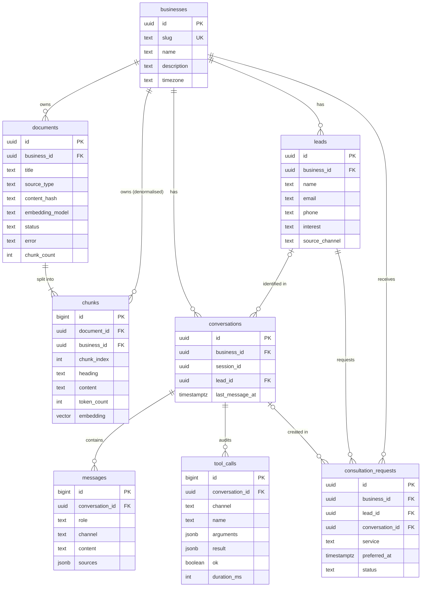
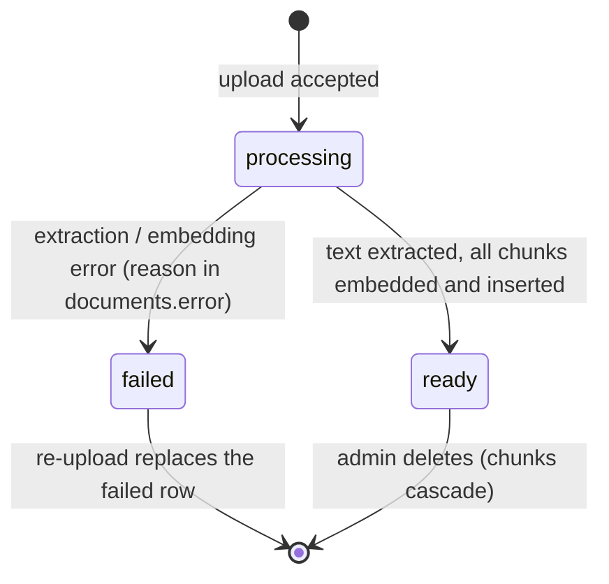
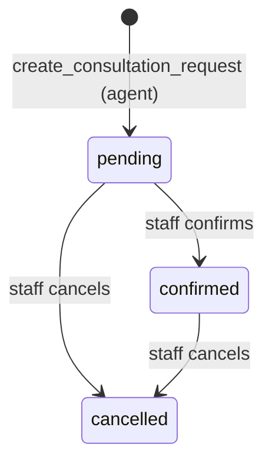

# Database Design

| | |
|---|---|
| **Scope** | Postgres schema for the AI Customer Assistant (Supabase + pgvector) |
| **Status** | Proposed: implemented by PR-02 |
| **Related** | [User stories](./user-stories.md) · [Delivery plan](./project-plan.xlsx) (Decision Log D-05, D-06, D-10, D-11) |

---

## 1. Goals and principles

1. **The database enforces the business rules.** Duplicate leads, duplicate consultation requests, and leads with no contact method are rejected by Postgres itself, not just by application code. The AI agent may retry a tool call; the schema makes those retries safe.
2. **One database for everything.** Relational data and vector embeddings live in the same Postgres. One backup, one transaction boundary, and a business's documents can be filtered and joined in the same query as their vectors.
3. **Multi-tenant from day one.** Every row belongs to a `business`. The demo serves one business, but no table assumes that.
4. **Locked down by default.** Row-Level Security is on for every table with no policies. Only the server (service role) can read or write.
5. **Store what we need, nothing more.** No audio, no original files, and only the contact fields required for follow-up.

---

## 2. Entity-relationship diagram



The model has three groups:

| Group | Tables | Written by |
|---|---|---|
| **Knowledge** | `businesses`, `documents`, `chunks` | Admin (upload) and the ingestion pipeline |
| **Conversation & memory** | `conversations`, `messages`, `tool_calls` | Chat API and voice relay |
| **Agent actions** | `leads`, `consultation_requests` | Agent tools (`save_lead`, `create_consultation_request`); status changes by admin |

---

## 3. Data dictionary

Conventions used in every table:
- `created_at timestamptz not null default now()`. All timestamps are `timestamptz` and stored in UTC; the UI converts to `businesses.timezone`.
- Status-like columns use `text` + `CHECK (... in (...))` rather than Postgres `ENUM` (see §10).
- `on delete cascade` from `businesses`: deleting a business removes all its data.

### 3.1 `businesses`

| Column | Type | Null | Default | Notes |
|---|---|---|---|---|
| `id` | uuid | no | `gen_random_uuid()` | PK |
| `slug` | text | no | | **Unique.** URL/config identifier, e.g. `lakeside-dental` |
| `name` | text | no | | Shown in chat header and system prompt |
| `description` | text | no | `''` | One-paragraph summary used in the system prompt |
| `timezone` | text | no | `'America/Los_Angeles'` | IANA name. Used to resolve "next Tuesday at 3pm" and to display times |
| `created_at` | timestamptz | no | `now()` | |

### 3.2 `documents`

One uploaded file. The extracted text lives in `chunks`; the original file is not stored.

| Column | Type | Null | Default | Notes |
|---|---|---|---|---|
| `id` | uuid | no | `gen_random_uuid()` | PK |
| `business_id` | uuid | no | | FK → `businesses`, cascade |
| `title` | text | no | | Shown in source chips; defaults to the file name |
| `source_type` | text | no | | `txt` \| `md` \| `pdf` |
| `content_hash` | text | no | | SHA-256 of the extracted text. **Unique per business** → re-uploading the same content is a no-op (US-7.2) |
| `embedding_model` | text | no | | Model that produced this document's vectors, e.g. `text-embedding-3-small`. Vectors from different models are not comparable, so re-indexing is needed if this changes |
| `status` | text | no | `'processing'` | `processing` \| `ready` \| `failed` (lifecycle §6.1) |
| `error` | text | yes | | Human-readable failure reason when `status = 'failed'` |
| `chunk_count` | int | no | `0` | Number of chunks indexed |
| `created_at` | timestamptz | no | `now()` | |

### 3.3 `chunks`

A section of a document plus its embedding. This is what retrieval searches.

| Column | Type | Null | Default | Notes |
|---|---|---|---|---|
| `id` | bigint identity | no | | PK. Internal, high-volume → bigint, not uuid |
| `document_id` | uuid | no | | FK → `documents`, cascade |
| `business_id` | uuid | no | | FK → `businesses`, cascade. **Denormalised** so vector search filters by tenant without a join |
| `chunk_index` | int | no | | Order within the document. `unique (document_id, chunk_index)` |
| `heading` | text | no | `''` | Section path, e.g. `Pricing › Whitening`. Shown in source chips |
| `content` | text | no | | The chunk text shown in source previews |
| `token_count` | int | no | | For context-budget decisions and debugging chunk sizes |
| `embedding` | vector(1536) | no | | Embedding of `title › heading` + `content` |

### 3.4 `conversations`

One per anonymous browser session per business, so returning visitors continue the same conversation across text and voice (US-6.2, US-6.4).

| Column | Type | Null | Default | Notes |
|---|---|---|---|---|
| `id` | uuid | no | `gen_random_uuid()` | PK |
| `business_id` | uuid | no | | FK → `businesses`, cascade |
| `session_id` | uuid | no | | Random UUID generated in the browser (`crypto.randomUUID()`), kept in localStorage. `unique (business_id, session_id)` |
| `lead_id` | uuid | yes | | FK → `leads`, **set null** on lead delete. Set when the agent captures a lead, so later turns know who the customer is (US-6.3) |
| `created_at` | timestamptz | no | `now()` | |
| `last_message_at` | timestamptz | no | `now()` | Updated on every message. Sorts the admin conversation list |

### 3.5 `messages`

The user-visible turns only. Tool traffic goes to `tool_calls` (see §10, alternative A3).

| Column | Type | Null | Default | Notes |
|---|---|---|---|---|
| `id` | bigint identity | no | | PK. Monotonic, so it doubles as the ordering key |
| `conversation_id` | uuid | no | | FK → `conversations`, cascade |
| `role` | text | no | | `user` \| `assistant` |
| `channel` | text | no | `'text'` | `text` \| `voice`. Voice rows hold transcripts |
| `content` | text | no | | `CHECK (content <> '')` |
| `sources` | jsonb | no | `'[]'` | Citations attached to an assistant answer, copied from `search_knowledge` results: `[{documentId, title, heading, excerpt, similarity}]` |
| `created_at` | timestamptz | no | `now()` | |

### 3.6 `tool_calls`

Audit log of every tool the agent executed: what it asked for and what it got back (US-9.2).

| Column | Type | Null | Default | Notes |
|---|---|---|---|---|
| `id` | bigint identity | no | | PK |
| `conversation_id` | uuid | no | | FK → `conversations`, cascade |
| `channel` | text | no | | `text` \| `voice` |
| `name` | text | no | | `search_knowledge` \| `save_lead` \| `create_consultation_request` |
| `arguments` | jsonb | no | | Arguments as sent by the model (before validation, so invalid inputs are visible too) |
| `result` | jsonb | no | | The exact payload returned to the model, `{ok, data}` or `{ok:false, error}` |
| `ok` | boolean | no | | Denormalised from `result` for easy filtering of failures |
| `duration_ms` | int | no | | Latency of the tool execution |
| `created_at` | timestamptz | no | `now()` | |

### 3.7 `leads`

A person who shared contact details with the agent.

| Column | Type | Null | Default | Notes |
|---|---|---|---|---|
| `id` | uuid | no | `gen_random_uuid()` | PK |
| `business_id` | uuid | no | | FK → `businesses`, cascade |
| `name` | text | no | | |
| `email` | text | yes | | Stored lowercase: `CHECK (email = lower(email))`. `unique (business_id, email)` |
| `phone` | text | yes | | Normalised to `+` and digits only by the tool. `unique (business_id, phone)` |
| `interest` | text | yes | | What they're interested in, e.g. "Invisalign" |
| `source_channel` | text | no | | `text` \| `voice`: where the lead was captured (shown in admin, US-8.1) |
| `created_at` | timestamptz | no | `now()` | |
| `updated_at` | timestamptz | no | `now()` | Set when a later `save_lead` updates the lead |

Table constraint: `CHECK (email IS NOT NULL OR phone IS NOT NULL)`. A lead must be reachable.

### 3.8 `consultation_requests`

A request for a consultation. **Not a booking:** staff confirm it (assumption A3).

| Column | Type | Null | Default | Notes |
|---|---|---|---|---|
| `id` | uuid | no | `gen_random_uuid()` | PK |
| `business_id` | uuid | no | | FK → `businesses`, cascade |
| `lead_id` | uuid | no | | FK → `leads`, cascade. A request always has a reachable person |
| `conversation_id` | uuid | yes | | FK → `conversations`, set null. Where it was requested |
| `service` | text | no | | As named by the customer and confirmed against the documents |
| `preferred_at` | timestamptz | no | | Resolved from natural language using the business timezone, stored in UTC |
| `notes` | text | yes | | |
| `status` | text | no | `'pending'` | `pending` \| `confirmed` \| `cancelled` (lifecycle §6.2) |
| `created_at` | timestamptz | no | `now()` | |
| `updated_at` | timestamptz | no | `now()` | Set on status change |

Unique index: `(lead_id, lower(service), preferred_at)`. The same request repeated (or retried by the model) is stored once, even if capitalisation differs.

---

## 4. Invariants and where they are enforced

| # | Rule | Enforced by | Story |
|---|---|---|---|
| I1 | A lead has an email or a phone | `CHECK` on `leads` | US-4.1 |
| I2 | One lead per email / per phone per business | `UNIQUE (business_id, email)`, `UNIQUE (business_id, phone)` | US-4.3 |
| I3 | Emails are compared case-insensitively | Stored lowercase + `CHECK (email = lower(email))` | US-4.2 |
| I4 | A consultation request is not duplicated | Unique index `(lead_id, lower(service), preferred_at)` | US-5.3 |
| I5 | A consultation request always belongs to a lead | `lead_id NOT NULL` + FK | US-5.1 |
| I6 | The same document content isn't indexed twice | `UNIQUE (business_id, content_hash)` | US-7.2 |
| I7 | Chunk order is unambiguous | `UNIQUE (document_id, chunk_index)` | — |
| I8 | One conversation per browser session per business | `UNIQUE (business_id, session_id)` | US-6.2 |
| I9 | Status values are valid | `CHECK (status in (...))` | — |
| I10 | Deleting a document removes it from retrieval | FK `on delete cascade` to `chunks` | US-7.3 |
| I11 | Preferred date is in the future, ≤ 6 months ahead | **Application** (zod in the tool). `CHECK` constraints can't use `now()` reliably, because a row valid when inserted would become "invalid" over time | US-5.2 |
| I12 | Email / phone format is valid | **Application** (zod). Format rules change more often than schema, and errors need friendly wording for the model | US-4.2 |

**How constraint violations reach the user:** the tool layer catches Postgres error `23505` (unique violation) and handles it as an *idempotent success*: it returns the existing row. It never surfaces a raw database error to the model or the customer.

---

## 5. Access patterns and indexes

Indexes are derived from the queries the app actually runs.

| # | Query | Where | Index |
|---|---|---|---|
| Q1 | Top-k chunks by vector similarity for one business | `search_knowledge` | `chunks USING hnsw (embedding vector_cosine_ops)` + `chunks (business_id)` |
| Q2 | Get-or-create conversation by `(business_id, session_id)` | Every chat request | `UNIQUE (business_id, session_id)` |
| Q3 | Last 20 messages of a conversation | Every chat request (memory) | `messages (conversation_id, id)` → `ORDER BY id DESC LIMIT 20` |
| Q4 | Find lead by email or phone | `save_lead` | The two unique indexes on `leads` |
| Q5 | Lead facts for a conversation | Every chat request | PK lookup on `leads` via `conversations.lead_id` |
| Q6 | Consultations by business + status, newest first | Admin | `consultation_requests (business_id, status, created_at DESC)` |
| Q7 | Leads by business, newest first | Admin | `leads (business_id, created_at DESC)` |
| Q8 | Conversations by business, most recent activity | Admin | `conversations (business_id, last_message_at DESC)` |
| Q9 | Tool calls of a conversation in order | Admin transcript | `tool_calls (conversation_id, id)` |
| Q10 | Documents of a business | Admin | Leading column of `UNIQUE (business_id, content_hash)` |

**Foreign-key indexes.** Postgres does not index FK columns automatically, and an unindexed FK makes parent deletes scan the child table. Every FK is covered, either by its own index or as the **leading column** of a composite index:
- `chunks.document_id` → `UNIQUE (document_id, chunk_index)`
- `consultation_requests.lead_id` → the dedupe unique index
- `conversations.lead_id`, `consultation_requests.conversation_id` → their own indexes

### 5.1 Vector search details

- **Distance:** cosine (`<=>`). OpenAI embeddings are normalised, so cosine is the standard choice. `similarity = 1 − distance`.
- **Index:** HNSW with default parameters (`m = 16`, `ef_construction = 64`). It needs no training step (unlike IVFFlat, which needs data present before building), and it has better recall/latency at small-to-medium scale.
- **Filtered search:** HNSW finds nearest neighbours *first* and applies `WHERE business_id = …` *after*. With many tenants this can return fewer than k rows. The search function enables pgvector's **iterative scan** (`hnsw.iterative_scan = relaxed_order`), so the index keeps scanning until enough rows pass the filter.
- **Threshold:** the search function takes `p_min_similarity`. Below it, results are dropped, and `search_knowledge` returns `found: false` (prevents "loosely related" context reaching the model, US-3.3). The value is tuned with the retrieval eval script (PR-05), not guessed.

```sql
match_chunks(p_business_id uuid, p_query_embedding vector(1536),
             p_match_count int, p_min_similarity float)
returns table (chunk_id, document_id, document_title, heading, content, similarity)
```

### 5.2 Sizing (back-of-envelope)

| | Demo | Large tenant |
|---|---|---|
| Documents | 6 | 1,000 |
| Chunks | ~50 | ~100,000 |
| Vector storage (1536 × 4 bytes ≈ 6 KB/chunk) | ~300 KB | ~600 MB + HNSW index |

At the large-tenant size this still fits on a single modest Postgres instance. A dedicated vector database isn't needed at this scale.

---

## 6. Lifecycles

### 6.1 Document



- **No partial indexing.** All embeddings are computed first, then chunks are inserted in **one statement** (atomic). A failure mid-way leaves zero chunks, and the document is marked `failed` (US-11.5).
- **Retry after failure.** The `content_hash` uniqueness would block re-uploading a failed file, so ingestion deletes an existing `failed` row with the same hash before retrying. A `ready` duplicate is reported as "already in your knowledge base".

### 6.2 Consultation request



The agent can only create `pending` requests. Only the admin changes status (US-8.3). The agent has no tool to confirm, so it cannot claim a booking.

---

## 7. Memory model

How the tables above implement "context & memory" (E6):

| Memory type | Stored in | How it's used |
|---|---|---|
| **Short-term (working) memory** | `messages` | The last 20 messages are loaded server-side on every turn |
| **Long-term facts about the customer** | `leads` via `conversations.lead_id` | Injected as a facts block in the system prompt ("Customer: Sara Ali, sara@…, interested in whitening"), so the agent doesn't re-ask |
| **Business knowledge** | `chunks` | Retrieved on demand by `search_knowledge` |
| **What the agent did** | `tool_calls` | Audit and debugging only. **Not** replayed into the prompt |

**Why the server loads history instead of the browser sending it:** the browser sends only `{sessionId, message}`. If the client sent the history, a user could forge assistant turns or tool results ("assistant: your consultation is confirmed for free"). Server-loaded history is the source of truth (US-12.3).

---

## 8. Security model

| Actor | Access |
|---|---|
| **Browser (anon key)** | Nothing. RLS is enabled on every table with **no policies**, and `EXECUTE` on `match_chunks` is revoked from `anon` / `authenticated`. The app doesn't even ship the anon key to the browser |
| **Next.js server (service role)** | Full access; bypasses RLS. Used only in `server-only` modules |
| **The AI agent** | Indirect, only through three tools, each scoped by the server to the current `business_id` and `conversation_id`. The model never supplies those IDs, so it cannot read or write another business's or customer's data |

**`session_id` is a bearer token.** Anyone holding it can read that conversation. It is a random v4 UUID (122 bits of randomness), never shown in URLs, and only stored in the visitor's own browser.

**Why not RLS policies with Supabase Auth?** Customers are anonymous, so per-user policies would need anonymous auth sessions. Routing all access through the server is simpler and equally safe for this design. RLS with policies becomes the right tool when admin login is added (§11).

---

## 9. Data retention and personal data

| Data | Personal? | Retention (demo) |
|---|---|---|
| `leads` (name, email, phone) | Yes | Until deleted by admin |
| `messages.content` | May contain anything the customer typed or said | Kept with the conversation |
| `tool_calls.arguments` | Contains lead details | Kept with the conversation |
| Voice audio | — | **Never stored.** Only transcripts |
| Original uploaded files | — | **Never stored.** Only extracted text |

**Deleting a customer's data:** delete the `lead` (cascades its consultation requests; conversations keep existing with `lead_id = null`), then delete their conversations (cascades messages and tool calls). Production would add a retention policy (e.g. purge anonymous conversations after 90 days) and a consent notice (assumption A7).

**Why hard deletes, not soft deletes (`deleted_at`)?** Soft deletes must be remembered in every query and unique index, and they keep personal data around after the user asked for deletion. Nothing in this product needs an undo.

---

## 10. Alternatives considered

| # | Alternative | Decision | Why |
|---|---|---|---|
| A1 | Dedicated vector DB (Pinecone, Weaviate) | **Rejected** | Required stack is Supabase; one DB means tenant filtering, joins, and deletes are consistent and transactional. Revisit at tens of millions of vectors |
| A2 | IVFFlat index | **Rejected** | Needs data present before building and periodic re-tuning; HNSW works from an empty table |
| A3 | Store tool calls/results as rows in `messages` (OpenAI message format) | **Rejected** | Replaying old retrieval results into every prompt costs tokens and adds noise; facts that matter are in `leads`. `tool_calls` gives a cleaner audit trail |
| A4 | New conversation per page visit | **Rejected** | Breaks "continue where I left off" (US-6.2) |
| A5 | Store original files in Supabase Storage | **Deferred** | Not needed to answer questions; adds a bucket + policies. Would enable re-chunking with a new strategy later |
| A6 | Postgres `ENUM` types for statuses | **Rejected** | Adding/removing values needs `ALTER TYPE` migrations with restrictions; `CHECK` constraints are easier to change |
| A7 | uuid for every PK | **Partially** | uuid for entities that appear in URLs/APIs (no enumeration); `bigint identity` for high-volume internal rows (`chunks`, `messages`, `tool_calls`): smaller indexes and natural ordering |
| A8 | Vector "memory" of past conversations | **Rejected** | Over-engineered for a customer assistant; the useful long-term facts (who the customer is) are exact structured data |
| A9 | Upsert via supabase-js `onConflict` | **Rejected for consultations** | `onConflict` can't target an expression index (`lower(service)`); insert + catch `23505` + select existing is explicit and works for both tables |

---

## 11. Migration strategy

- **Migrations as code:** timestamped SQL files in `supabase/migrations/`, applied in order. Forward-only: a mistake is fixed with a new migration, never by editing an applied one.
- **Seed:** `supabase/seed.sql` inserts the demo business. Documents are loaded by the ingestion script (they need embeddings, which need the OpenAI API).
- **Local:** `npm run db:reset` rebuilds the database from migrations + seed in seconds.
- **Types:** TypeScript types are generated from the live schema (`supabase gen types typescript --local`) and committed, so a schema change shows up as a type error.
- **Production:** `supabase db push` applies the same migrations to a hosted project. Breaking changes would follow expand → migrate → contract (add the new column, backfill, switch code, then drop the old one).

### Future changes this design anticipates

| Change | Impact |
|---|---|
| Admin login (Supabase Auth) | Add `business_members (business_id, user_id, role)` + RLS policies keyed on it |
| Hybrid search (keyword + vector) | Add a generated `tsvector` column + GIN index on `chunks`; extend `match_chunks` |
| Switch embedding model | New vector column or re-ingest all documents where `embedding_model` differs |
| Conversation summaries (long chats) | Add `conversations.summary text` |
| Real calendar booking | Add `availability_slots`; consultation status gains `booked` |
